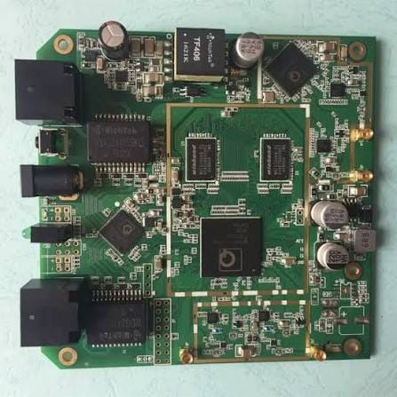

# CreatComm Technology TA8H OpenWrt 23.05.5 by Anant Kushwaha

[](https://openwrt.org/)
[](https://www.qualcomm.com/)
[](https://openwrt.org/)
[](https://openwrt.org/)
[](https://github.com/anantkushwaha2002-ai)
[](LICENSE)

An optimized, fully modernized OpenWrt 23.05.5 (Linux Kernel 5.15 LTS / `ath79` Device Tree) firmware build for the **CreatComm Technology TA8H** high-power outdoor wireless access point. Customized and maintained by **Anant Kushwaha**.

This release cleanly transitions the board from the obsolete **`ar71xx`** target (LEDE 17.01.4 / Linux 4.4) to the modern, mainline **`ath79/generic`** architecture with full LuCI, working OPKG package feeds, and stable dual-band Wi-Fi.

---

## 📋 Hardware Specifications

<table>
<tr>
<td width="55%" valign="top">

| Component | Specification |
| :--- | :--- |
| **Model / Board** | CreatComm Technology TA8H (`creatcomm,ta8h`) |
| **SoC** | Qualcomm Atheros QCA9558 ver 1 rev 0 @ 720 MHz |
| **CPU Architecture** | MIPS 74Kc (32-bit Big-Endian, `mips_24kc`) |
| **RAM** | 128 MB DDR2 (2x Winbond DRAM @ 600 MHz) |
| **Flash** | 16 MB Winbond SPI-NOR Flash (`w25q128`) |
| **Gigabit Switch** | Qualcomm Atheros AR8337 Rev 2 (Dual CPU RGMII/SGMII) |
| **Wireless 2.4 GHz** | SoC internal `ath9k` **2x2 MIMO** 802.11b/g/n (up to 300 Mbps, 27 dBm) |
| **Wireless 5 GHz** | PCIe `ath10k` QCA9880 / QCA9882 **2x2 MIMO** 802.11ac (up to 867 Mbps, 30 dBm) |
| **Ethernet Ports** | 2x Gigabit Ethernet (1x LAN, 1x WAN with 48V PoE-In) |
| **DC Power Jack** | **24V – 36V DC** (Center-Positive 5.5x2.1/2.5mm; 12V is NOT supported!) |
| **PoE Power** | **48V Active (802.3af/at) or 48V Passive PoE** on WAN Port |

</td>
<td width="45%" align="center" valign="middle">


<br />
<em>CreatComm Technology TA8H Hardware Board</em>

</td>
</tr>
</table>

> [!WARNING]
> **DC Power Jack Voltage Requirement (24V – 36V DC):**  
> This industrial outdoor board employs an onboard step-down DC-DC switching regulator designed for long-distance cable runs.  
> • **Standard 12V DC power adapters WILL NOT WORK** — the board will fail to power on or enter an endless boot loop because 12V does not meet the step-down regulator's input threshold.  
> • **Required DC Jack Voltage**: **24V to 36V DC** (nominal 24V or 36V center-positive, up to 48V).  
> • **PoE Supply**: Standard **48V PoE (802.3af/at)** or **48V Passive PoE** injector connected to the **WAN** Ethernet port.

---

### 🔌 Hardware Pinouts & Interfaces

| Interface | Physical Location / Mapping | Operating Parameters |
| :--- | :--- | :--- |
| **Serial Console (UART)** | Header `J2` (2x5 pin header) | **115200 Baud, 8N1, 3.3V TTL**. Pinout: `GND`, `TX`, `RX`, `VCC` (*Note: Leave 3.3V VCC disconnected!*). TTY Device: `ttyS0`. |
| **Factory Reset Button** | Tactile Switch on PCB Edge | **GPIO 16** (Active LOW, 60ms debounce). Hold at boot for failsafe. |
| **Status LED** | Onboard Surface Mount LED | **GPIO 21** (Active LOW, default ON). |
| **2.4 GHz WLAN LED** | Onboard Surface Mount LED | **GPIO 22** (Active LOW, default trigger: `phy1tpt`). |
| **5 GHz WLAN LED** | Onboard Surface Mount LED | **GPIO 23** (Active LOW, default trigger: `phy0tpt`). |
| **Ethernet WAN Port** | RJ45 Port (Left/PoE In) | AR8337 Switch **Port 2**, attached via `eth0` (RGMII). Supports 48V PoE. |
| **Ethernet LAN Port** | RJ45 Port (Right) | AR8337 Switch **Port 3**, attached via `eth0` (RGMII). Standard Gigabit LAN. |

---

### 💾 SPI-NOR Flash Memory Layout (16 MB Winbond W25Q128)

| Partition Name | Start Offset | End Offset | Partition Size | Read/Write | Function & Safety Instructions |
| :--- | :--- | :--- | :--- | :--- | :--- |
| **`u-boot`** | `0x00000000` | `0x00040000` | 256 KB | Read-Only | Primary U-Boot bootloader (Qualcomm Atheros 115200 baud). |
| **`u-boot-env`** | `0x00040000` | `0x00050000` | 64 KB | Read/Write | Bootloader environment variables (`bootcmd`, `serverip`, etc.). |
| **`firmware`** | `0x00050000` | `0x00ff0000` | 15.625 MB (16,000 KB) | Read/Write | OpenWrt Linux kernel (`uImage`) + SquashFS root filesystem + JFFS2 writable overlay. |
| **`art`** | `0x00ff0000` | `0x01000000` | 64 KB | Read-Only | **Atheros Radio Test (ART)**. Holds factory RF calibration offsets & MAC addresses. **NEVER OVERWRITE!** |

---

## 🚀 Key Highlights

* **Modern ath79 Device Tree Architecture**:
  * Upgrades the obsolete 2017 `ar71xx` build (Linux 4.4) to modern OpenWrt 23.05.5 (Linux 5.15.167 LTS).
  * Native Device Tree (`dts`) bindings with accurate switch pad delays (`pad0_cfg = 0x03000101`, `pad6_cfg = 0x4a000000`) for wire-speed Gigabit routing.
* **Dual-Band 2x2 MIMO High-Power Wireless**:
  * **5 GHz AC**: Pre-configured `OpenWrt_5G` on Channel 44 (80 MHz VHT80, 30 dBm / 1 Watt transmit power) powered by `ath10k-ct`.
  * **2.4 GHz N**: Pre-configured `OpenWrt_2.4G` on Channel 1 (40 MHz HT40, 27 dBm / 500 mW transmit power) powered by `ath9k`.
* **Verified Official OPKG Software Feeds**:
  * Connected directly to official `downloads.openwrt.org/releases/23.05.5/` feeds with valid signature verification.
  * `luci-app-opkg` pre-installed for 1-click package management in the LuCI web interface.
* **Hardware & ART Partition Safety**:
  * Firmware size (~6.06 MB) safely fits within the 15.6 MB partition.
  * Completely protects factory RF calibration data and MAC addresses in the **ART partition** (`0x00ff0000 - 0x01000000`).

---

## 📥 Firmware Downloads

| Firmware File | Description | Size | Download Link |
| :--- | :--- | :--- | :--- |
| **`openwrt-sysupgrade-ta8h.bin`** | Permanent Sysupgrade Firmware Image | ~6.06 MB | [📥 Download Sysupgrade (.bin)](https://github.com/anantkushwaha2002-ai/openwrt-creatcomm-ta8h/releases/download/v1.0.0/openwrt-sysupgrade-ta8h.bin) |
| **`openwrt-initramfs-ta8h.bin`** | Safe RAM Test Firmware (Zero Flash Writes) | ~5.38 MB | [📥 Download Initramfs (.bin)](https://github.com/anantkushwaha2002-ai/openwrt-creatcomm-ta8h/releases/download/v1.0.0/openwrt-initramfs-ta8h.bin) |

---

## 🛠️ Step-by-Step Installation Guide

> [!IMPORTANT]
> **Why Browser Upload From Old Firmware Fails:**  
> The original firmware (MAKSAT Meshmax / LEDE 17.01) runs on the legacy **`ar71xx`** platform. If you try to upload modern **`ath79`** images directly in the old LuCI web browser interface, it will reject the image with an *"Image verification failed"* or *"Unsupported format"* warning due to the target architecture transition. Follow either **Method 1** (Recommended & Safest) or **Method 2** below.

### Method 1: Safe RAM Boot via TFTP (Recommended / Zero Risk)
This method boots OpenWrt purely inside the 128 MB DDR2 RAM without writing a single byte to the flash chip:

1. Download **`openwrt-initramfs-ta8h.bin`** and place it in your TFTP server folder (e.g. Tftpd64).
2. Set your PC's Ethernet IPv4 address to:
   * **IP Address**: `192.168.1.10`
   * **Subnet Mask**: `255.255.255.0`
   * **Gateway**: `192.168.1.1`
3. Connect an Ethernet cable from your PC to the router's LAN port.
4. Connect a USB-to-UART TTL serial adapter (115200 baud, 8N1) to the router header.
5. Power on the board and press any key to enter the **U-Boot** prompt (`ath> `).
6. Run the following commands (using the verified high-memory address **`0x82000000`** to prevent memory overwrite):
   ```bash
   setenv ipaddr 192.168.1.1
   setenv serverip 192.168.1.10
   tftpboot 0x82000000 openwrt-initramfs-ta8h.bin
   bootm 0x82000000
   ```

   > [!NOTE]
   > **Why `0x82000000` Must Be Used (Technical Rationale):**  
   > The Linux kernel uImage header specifies decompression target `ih_load = 0x80060000` and entry point `ih_ep = 0x80060000`. If you download the TFTP image directly to `0x80060000` (or `0x80000000`), U-Boot's `bootm` LZMA decompressor will write uncompressed data into `0x80060000` while simultaneously reading from it, overwriting its own compressed source bytes and failing with a crash or *LZMA ERROR 1 / Bad Magic*.  
   > Loading the image at high RAM offset **`0x82000000`** (32 MB into the 128 MB DDR2 RAM) completely separates the source archive from the decompression buffer at `0x80060000`, guaranteeing a 100% clean boot.
7. **Accessing the RAM System**:
   * Both the RAM temporary build and Sysupgrade use the unified standard OpenWrt IP: **`192.168.1.1`**.
   * Set your PC to `192.168.1.10` (or obtain IP automatically via DHCP).
   * Open your web browser at: **`http://192.168.1.1/`** (LuCI WebUI).
8. **Permanent Flashing from RAM**:
   * In LuCI, go to **System -> Backup / Flash Firmware**.
   * Upload **`openwrt-sysupgrade-ta8h.bin`**.
   * **Uncheck** "Keep settings" and click **Flash**!

---

### Method 2: Direct CLI Sysupgrade via SSH (Without Opening the Case)
If you already have SSH access to your original router on its existing IP (e.g. `192.168.10.2`):

1. Copy the sysupgrade binary to the router's `/tmp` directory using SCP:
   ```bash
   scp openwrt-sysupgrade-ta8h.bin root@192.168.10.2:/tmp/
   ```
2. Log in via SSH:
   ```bash
   ssh root@192.168.10.2
   ```
3. Run `sysupgrade` with the force (`-F`) and clean (`-n`) flags:
   ```bash
   sysupgrade -F -n /tmp/openwrt-sysupgrade-ta8h.bin
   ```
   *Explanation: `-F` overrides the target architecture check between `ar71xx` and `ath79`, and `-n` discards outdated 2017 settings to prevent crashes.*
4. Wait 2-3 minutes for the device to flash and reboot.

---

## 🌐 Network Configuration & Pre-Baked Zero-Touch OPKG

### Unified Default IP Addressing
* **Default IP Address**: **`192.168.1.1`** (standardized across BOTH temporary RAM boot and permanent Sysupgrade images).
* **Default Credentials**: Username `root`, No password by default.
* **LuCI Web Interface**: Accessible immediately at `http://192.168.1.1`.

### ✨ Pre-Baked DNS & Out-of-the-Box OPKG Support
In standard OpenWrt, setting a static IP or using an Access Point setup often causes `opkg update` to fail with DNS lookup errors (`wget: bad address 'downloads.openwrt.org'`).

In this customized release by **Anant Kushwaha**, this is **permanently solved out-of-the-box**:
1. **Pre-baked Public DNS**: Both `8.8.8.8` (Google DNS) and `1.1.1.1` (Cloudflare DNS) are hardcoded directly into the system build defaults (`/etc/uci-defaults/99-ta8h-defaults`).
2. **Rebind Protection Disabled**: `dnsmasq` rebind protection is pre-configured to `0` so upstream public DNS queries are never dropped.
3. **Instant Package Updates**: As soon as your WAN/LAN interface is connected to the internet, simply running `opkg update` works 100% with no manual DNS or gateway setup needed!

---

## 🛠️ Complete Source Code & Developer Guide

This repository contains **100% of the source code, device tree sources, configuration patches, and build scripts** required to modify, re-tune, or rebuild this firmware from scratch.

### 📁 Repository Structure
```text
openwrt-creatcomm-ta8h/
├── dts/
│   ├── qca9558_creatcomm_ta8h.dts      # Standard mainline OpenWrt Device Tree source
│   ├── creatcomm_ta8h_generated.dts    # Standalone de-compiled DTS source
│   └── creatcomm_ta8h_generated.dtb    # Pre-compiled binary Device Tree Blob
├── patches/
│   ├── openwrt-ath79-creatcomm-ta8h.patch # Upstream git patch for official OpenWrt source
│   └── uci-defaults/
│       └── 99-ta8h-defaults            # System boot initialization script (Wi-Fi, DNS, AP)
├── scripts/
│   ├── build_sysupgrade.py             # Re-assembles openwrt-sysupgrade-ta8h.bin
│   ├── build_initramfs.py              # Re-assembles openwrt-initramfs-ta8h.bin
│   └── rebuild_both_firmwares.py       # Full automated re-builder for both images
├── images/
│   └── creatcomm_ta8h_board.jpg        # High-resolution hardware board PCB photo
├── LICENSE                             # MIT Open Source License
└── README.md                           # Documentation & flashing guide
```

---

### 🔧 How to Modify the Firmware

#### 1. Modifying Hardware Bindings (GPIOs, LEDs, Switch)
* Edit `dts/qca9558_creatcomm_ta8h.dts` or `dts/creatcomm_ta8h_generated.dts`.
* Change switch pad clock delays, Ethernet PHY modes (`rgmii` / `sgmii`), LED GPIO pins, or partition offsets.
* Recompile DTS to DTB using the standard device tree compiler (`dtc`):
  ```bash
  dtc -I dts -O dtb -o dts/creatcomm_ta8h_generated.dtb dts/creatcomm_ta8h_generated.dts
  ```

#### 2. Modifying Network, Wi-Fi & System Defaults
* Edit `patches/uci-defaults/99-ta8h-defaults`.
* Customize default SSIDs (`OpenWrt_5G`, `OpenWrt_2.4G`), default IP address, channel assignments, transmit powers, or upstream DNS servers (`8.8.8.8`, `1.1.1.1`).

#### 3. Rebuilding the Firmware Binaries (Quick Assembly)
Run the automated build script with Python 3:
```bash
python scripts/rebuild_both_firmwares.py
```
This script unpacks the SquashFS filesystem, applies the latest `uci-defaults`, repacks using `tar2sqfs`, compiles the kernel with the updated DTB, pads the partition boundaries, appends the verified `fwtool` metadata, and outputs:
* `openwrt-sysupgrade-ta8h.bin`
* `openwrt-initramfs-ta8h.bin`

#### 4. Building Directly Inside Official OpenWrt Source Tree
If you prefer compiling entirely from the official OpenWrt repository:
1. Clone the OpenWrt source tree:
   ```bash
   git clone -b openwrt-23.05 https://github.com/openwrt/openwrt.git
   cd openwrt
   ./scripts/feeds update -a && ./scripts/feeds install -a
   ```
2. Copy the DTS file:
   ```bash
   cp <path-to-repo>/dts/qca9558_creatcomm_ta8h.dts target/linux/ath79/dts/
   ```
3. Apply the device patch:
   ```bash
   git apply <path-to-repo>/patches/openwrt-ath79-creatcomm-ta8h.patch
   ```
4. Select `Qualcomm Atheros ath79 -> Generic -> CreatComm TA8H` in `make menuconfig` and run:
   ```bash
   make target/linux/compile -j$(nproc)
   ```

---

## 🤖 AI Agent & LLM Developer Specification Block

> [!NOTE]
> If you are an autonomous AI coding agent (e.g. Claude, ChatGPT, Cursor, Gemini, Copilot, or Antigravity) tasked with modifying, optimizing, or building custom images for this router, use the following authoritative hardware & build specifications:

```yaml
target_hardware:
  board_model: "CreatComm Technology TA8H"
  openwrt_target: "ath79/generic"
  dts_compatible: ["creatcomm,ta8h", "qca,qca9558"]
  soc: "Qualcomm Atheros QCA9558 ver 1 rev 0 @ 720 MHz"
  cpu_architecture: "MIPS 74Kc (mips_24kc, 32-bit Big-Endian)"
  ram: "128 MB DDR2 (Winbond, 600 MHz)"
  flash: "16 MB SPI-NOR (Winbond W25Q128, 50MHz)"
  switch:
    model: "Qualcomm Atheros AR8337 Rev 2"
    rgmii_pad0: "0x03000101 (attached to CPU eth0)"
    sgmii_pad6: "0x4a000000 (attached to CPU eth1)"
    port_mapping:
      port_0: "CPU eth0 (RGMII)"
      port_2: "WAN / 48V PoE In (switch0.1)"
      port_3: "LAN (switch0.1)"
      port_6: "CPU eth1 (SGMII)"
  wireless:
    wlan_2g:
      chip: "SoC internal ath9k"
      mimo: "2x2 MIMO 802.11b/g/n (up to 300 Mbps)"
      cal_data: "art partition offset 0x1000 (length: 0x440)"
      mac_addr: "art partition offset 0x0000 (length: 0x6)"
    wlan_5g:
      chip: "PCIe Mini-Card ath10k (QCA9880 / QCA9882)"
      mimo: "2x2 MIMO 802.11ac (up to 867 Mbps)"
      cal_data: "art partition offset 0x5000 (length: 0x844)"
      mac_addr: "art partition offset 0x0006 (length: 0x6)"
  power_requirements:
    dc_barrel_jack: "24V - 36V DC (Center-Positive, wide input up to 48V; 12V strictly unsupported!)"
    poe_in: "48V Active (802.3af/at) or 48V Passive PoE on WAN port"
  gpio_mappings:
    reset_button: "GPIO 16 (Active LOW)"
    status_led: "GPIO 21 (Active LOW)"
    wlan2g_led: "GPIO 22 (Active LOW, phy1tpt)"
    wlan5g_led: "GPIO 23 (Active LOW, phy0tpt)"
  uart_serial:
    header: "J2 (2x5 pin header)"
    parameters: "115200 baud, 8 data bits, no parity, 1 stop bit (8N1), 3.3V TTL"
    device: "ttyS0"
  u_boot_parameters:
    decompression_target: "0x80060000 (kernel ih_load / ih_ep)"
    tftp_safe_load_addr: "0x82000000 (prevents memory collision during LZMA decompress)"
```

---

## 👤 Author & Credits

* **Firmware Customization, Optimization & Maintenance**: **Anant Kushwaha**
* **Upstream Base**: [OpenWrt Project](https://openwrt.org/) (`ath79/generic`) & CreatComm Technology Co., Ltd.
* **License**: Released under the permissive **[MIT License](LICENSE)** — free for anyone to use, modify, and distribute.
